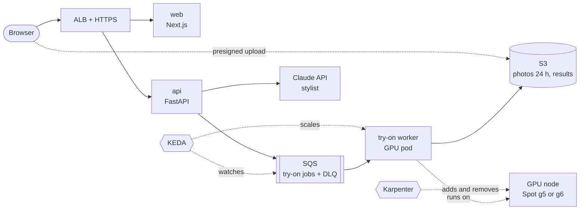

# Scope

Kisekae (着せ替え, "dress-up") lets a shopper see themselves in clothes before buying. It is part 3 of AI on EKS: the
first part with GPUs, run so that you pay only while someone is trying something on.

- **It is** a virtual try-on for fashion stores: a photo of you plus a garment gives a photo of you wearing it, and
  a stylist suggests what goes with it. The model runs on your own GPUs in EKS.
- **It is not** an image editor for people. It swaps clothes over clothes on photos of yourself, and nothing else.

## Why fashion

Clothes bought online are returned far more often than most products, mostly because they don't fit or don't look
as expected. Try-on is the feature fashion stores want, and the result is one image anyone understands. It is also
the right first GPU workload: one model, one job per request, and long quiet periods where a GPU should cost
nothing.

## The product

| Actor | Does |
|---|---|
| Shopper | Uploads a photo, tries on garments, shares results |
| Store (demo catalog) | Garment images and product data |

1. **Photo:** upload a front-facing photo of yourself (presigned upload to S3). A safety check runs first.
2. **Garment:** pick from the demo catalog, or upload a product photo of a top, bottom or dress.
3. **Try on:** a job goes to SQS; a GPU worker runs the try-on model and saves the image. The page shows each stage:
   queued, starting a GPU, rendering, done.
4. **Complete the look:** Claude looks at the result and picks two catalog items that go with it; they are rendered
   too.
5. **Share:** a card with the result and the items, labelled "AI try-on".

**API (v1):** `POST /v1/uploads`, `POST /v1/tryons`, `GET /v1/tryons/{id}`, `GET /v1/tryons/{id}/events`
(server-sent events), `POST /v1/looks`, `GET /v1/catalog`.

## Rules

| # | Rule | Enforced by |
|---|---|---|
| R1 | Photos are private and short-lived. | Private bucket, presigned URLs that expire in minutes, deletion after 24 hours (job plus S3 lifecycle), never used for training |
| R2 | Clothes over clothes only. No nudity, no photos of children. | Safety checks on every upload and every result; failures are rejected and not stored |
| R3 | Every result is labelled as AI-generated. | Label on the image and the share card |
| R4 | No job is lost, even on Spot. | Jobs stay in SQS until the result is saved; visibility timeout longer than a render; dead-letter queue after 3 tries |
| R5 | GPUs cost nothing when idle. | KEDA scales workers to zero; Karpenter removes empty GPU nodes; a cap on GPU nodes |

## Architecture (target)

## What it teaches on Kubernetes

New in part 3:

- Karpenter with a CPU NodePool and a GPU NodePool: Spot first, on-demand fallback, a limit on GPUs
- GPU scheduling: the NVIDIA device plugin, `nvidia.com/gpu` requests, taints and tolerations so only GPU work lands
  on GPU nodes
- KEDA scaling the workers on SQS queue depth, from zero
- Spot interruptions: Karpenter's interruption handling, and a worker that stops cleanly without losing its job
- Big images and model weights: weights cached in S3, cold start measured and then reduced

Reused from earlier parts: Argo CD and Helm, External Secrets, Pod Identity, ALB Ingress, NetworkPolicies.

## Models and licenses

| Task | Model | Runs on | License note |
|---|---|---|---|
| Try-on | Open-source try-on model (candidates: CatVTON, IDM-VTON, Leffa) | GPU worker | Several are licensed for non-commercial use only, which fits this learning-only project; the ADR records each license, and the worker interface lets you swap models |
| Safety | An image-safety classifier plus a moderation API | API (CPU) | Chosen in an ADR |
| Stylist | Claude (vision) | Claude API | |
| API-only mode | An image-editing API given both photos | No GPU | For accounts without GPU quota; results differ from the GPU model |

The ADR compares the candidates on quality, GPU memory, speed and license, on one 24 GB GPU.

## Results to publish

| Number | How it is measured |
|---|---|
| Cold start | First job with no GPU node → first image, before and after optimising |
| Warm render time | p50 and p95 per try-on |
| Throughput | Try-ons per minute per GPU |
| Cost per 1,000 try-ons | Spot and on-demand |
| Jobs lost in a Spot interruption drill | The target is none |

## Out of scope (v1)

Video try-on, 3D body models, size recommendations, real store integrations (Shopify and others).
